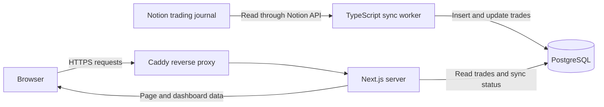
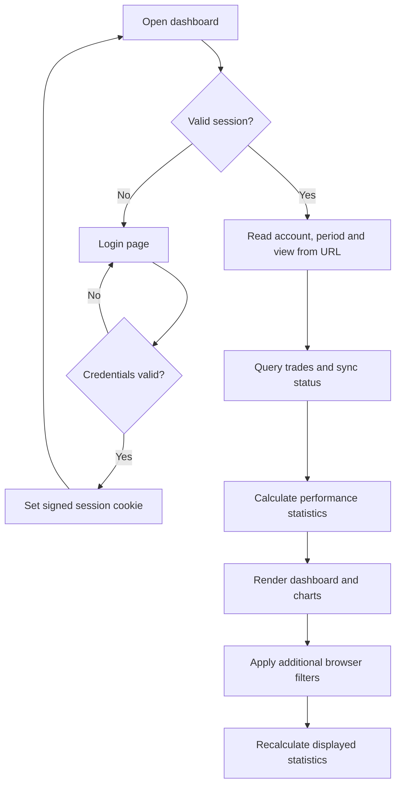

# GIMM Trading Dashboard

A personal trading dashboard built with Next.js, TypeScript and PostgreSQL. It turns the trades from my Notion journal into performance statistics, interactive charts and a searchable trade history.

## Why I built this

I use Notion to document trades, including setups, sessions and confirmations. That works well for keeping a journal, but I wanted a clearer way to compare results without exporting everything into spreadsheets.

The idea is to keep the workflow simple: record and edit trades in Notion, then use this dashboard to review them. The project follows my own journal structure rather than trying to reproduce every feature of a commercial trading platform.

## Features

- **Overview:** net P&L, win rate, profit factor, drawdown, equity, recorded account balance and recent trades.
- **Trade journal:** search, filtering, sorting, pagination, trade details and CSV export.
- **Trading calendar:** daily results, trade counts and drilldown into a selected day.
- **Analytics:** comparisons by setup, confirmations, session, weekday, entry hour and month; recorded Win/Loss confluence outcomes; 30-minute MFE/MAE averages, scatter plot and individual measurements.
- **Daily preparation:** a checklist and notes saved in the browser, separately for each day and account.
- **Filters:** Forwardtesting, Backtest or all accounts; the last 30, 90 or 365 days, or all history. Additional filters cover instrument, setup, session, outcome and date range.
- **Interface:** private login, responsive navigation and light/dark themes.

## Architecture

The application has three services: a Next.js web application, a TypeScript synchronization worker and a PostgreSQL database. Docker Compose runs them together. The deployment configuration connects the web service to an existing Caddy HTTPS reverse proxy.



### 1. Notion: the original journal

Notion is the source of truth. Trades are created and edited there; the dashboard does not write changes back to Notion.

The adapter reads trade ID, account, entry time, instrument, position, net result in euros, account balance, R-multiple, setups and confirmations. It validates API responses with Zod and maps the properties into the application's `Trade` type. This mapping is specific to my journal: another Notion template may require changes in [lib/notion.ts](gimm-trading-dashboard/lib/notion.ts).

### 2. Worker: synchronization

The worker runs independently of the website. By default, it waits 180 seconds between completed synchronization attempts. Each run retrieves all available journal pages, following API pagination, then inserts new trades and updates existing ones using the Notion page ID as the key. This is a periodic full fetch, rather than an incremental feed or webhook integration.

Writes happen inside a database transaction. An advisory lock prevents overlapping runs from writing at the same time. Missing trades are removed only when the fetched dataset is nonempty and contains at least 60% of the previous row count, or when the database was empty. Otherwise, existing rows are retained and a warning is recorded. This helps avoid losing the stored history after an unexpectedly small API response.

Failed runs record an error when the database is reachable. The dashboard can still display the previously stored data together with its synchronization status.

### 3. PostgreSQL: the stored copy

| Table | Purpose |
| --- | --- |
| `trades` | Trade records, Notion identifiers and synchronization metadata. |
| `sync_status` | Last successful sync time, received trade count, state and error information. |

The website reads this copy instead of requesting Notion whenever someone opens a page. Page loading is therefore separate from Notion API availability. A Docker volume preserves the database across container restarts.

### 4. Next.js: backend and frontend

The backend and frontend belong to the same Next.js App Router project. There is no separate REST backend for trading data.

The server checks the session, reads the account and period from the URL, queries PostgreSQL and calculates the initial performance statistics. It passes the resulting payload to the React dashboard. Apache ECharts and TradingView Lightweight Charts render the visualizations in the browser.

Account and period changes trigger a server request. Additional filters run in the browser against the loaded trades and recalculate the displayed statistics. The four main views use the same route with different query parameters:

```text
/dashboard?view=analytics&account=Forwardtesting&period=90d
```

The browser refreshes server data every 90 seconds while the page is visible. A manual refresh button is also available. Refreshing reads PostgreSQL; it does not trigger a Notion sync. New trades appear after a successful worker run and a subsequent page refresh.



## How the statistics work

The main calculations live in [lib/analytics.ts](gimm-trading-dashboard/lib/analytics.ts), shared by the server and browser. A trade counts as closed for these calculations when it has a finite `Net €` value. Missing results are excluded from closed-trade statistics; zero counts as breakeven.

| Metric | Calculation |
| --- | --- |
| Net P&L | Sum of recorded net trade results. |
| Win rate | Winning trades divided by all closed trades, including breakeven trades. |
| Profit factor | Gross profit divided by absolute gross loss; unavailable when there is no gross loss. |
| Equity curve | Cumulative realized P&L, starting at zero. |
| Drawdown | Drop from the preceding peak of cumulative P&L, rather than an intratrade measurement. |
| Account balance | Values recorded in Notion, separately from cumulative P&L because they may include transfers. |

Notion Win/Loss tags are stored separately from Net €. Recorded confluence outcomes can include tagged trades without amounts; these trades remain excluded from financial statistics and display a missing-amount notice. Net € takes precedence over tags. TF Type comparisons include new tags automatically, including 5s Type 3. MFE/MAE read the exact journal fields `MFE(30 min)` and `MAE (30min)` without converting units; each average excludes only its missing measurements.

Calendar and timing groups use the configured timezone, defaulting to `Europe/Berlin`. Timing analysis uses entry times. Setup and session highlights require at least five closed trades per group. These comparisons describe the journal history; they are not predictions.

## Tech stack and design choices

| Technology | Role |
| --- | --- |
| Next.js 16, React 19, TypeScript | Server rendering, application routes and interactive UI. |
| Tailwind CSS, Radix UI, shadcn/ui-style components | Styling and reusable interface elements. |
| Apache ECharts, TradingView Lightweight Charts | Statistical charts and financial time series. |
| PostgreSQL 17, `pg` | Persistent storage and parameterized SQL queries. |
| Zod | Validation of Notion API responses. |
| TypeScript worker, Notion API | Periodic journal synchronization. |
| Docker Compose, Caddy | Service deployment and HTTPS routing. |

I kept the architecture small: one web application and one worker sharing a relational database. It fits a private dashboard without adding a separate API service, message queue or distributed job system.

## Project structure

```text
gimm-trading-dashboard/
├── app/
│   ├── dashboard/page.tsx   # Session check, data loading and calculations
│   ├── login/              # Login page and login/logout server actions
│   └── api/health/         # Database readiness endpoint
├── components/
│   ├── dashboard.tsx       # Workspace, navigation and browser filters
│   ├── dashboard/          # Journal, calendar, metrics and daily plan
│   ├── charts/             # Chart wrappers
│   └── ui/                 # Reusable interface components
├── lib/
│   ├── notion.ts           # API pagination, validation and field mapping
│   ├── sync.ts             # Transactional synchronization
│   ├── db.ts               # Connection pool, schema and queries
│   ├── analytics.ts        # Performance calculations
│   ├── journal.ts          # Journal summaries and daily grouping
│   └── auth*.ts            # Credentials and session handling
├── scripts/                # Worker, preview, checks and backup utilities
├── tests/                  # Unit tests
├── docs/                   # Authentication, preview and deployment guides
├── proxy.ts                # Early dashboard session check
├── compose.yaml            # Web, worker and database services
└── compose.local.yaml      # Separate local demo
```

## Try it locally

Requires Node.js 22.18 or newer and npm.

```sh
cd gimm-trading-dashboard
npm ci
npm run preview
```

Open the local address printed in the terminal. Demo login: username `preview`, password `gimm-local-preview-only`.

The preview builds an isolated copy with synthetic trades. It does not load private environment files, contact Notion or connect to PostgreSQL. These credentials belong only to the local demo. See the [preview guide](gimm-trading-dashboard/docs/local-preview.md) for the Docker alternative and browser checks.

## Connect your own journal

From the application directory:

1. Copy `.env.example` to `.env`. Replace the sample values with your Notion integration token, data source ID and database settings. Grant the integration read access to the journal.
2. Check the property mapping in `lib/notion.ts` against your Notion template.
3. Generate a password hash with `npm run auth:hash` and a session secret with `openssl rand -hex 32`. Add `AUTH_USERNAME`, `AUTH_PASSWORD_HASH` and `AUTH_SECRET` to `.env` following the [authentication guide](gimm-trading-dashboard/docs/authentication.md). Keep the hash single-quoted in the Compose environment file.
4. Adapt the external Caddy network and domain configuration to your server. The production Compose file refers to my existing Caddy network; it does not create a reverse proxy itself.
5. Follow the [deployment guide](gimm-trading-dashboard/docs/deployment-checklist.md) to build, start and verify the services.

The real application requires configured credentials and database access. A database failure produces an unavailable-data state, rather than sample results.

## Access and storage

The application supports one private account, with a salted scrypt password hash and signed session cookies. Cookies are HttpOnly, SameSite=Lax, Secure in production and expire after eight hours. Both the request proxy and dashboard page check the session before trade data is loaded.

The production Compose configuration does not publish the database or worker directly. Web database connections use read-only sessions; this is a connection setting, not a separate PostgreSQL role with restricted privileges. The worker can write to the database and receives the Notion credentials. The web container does not receive the Notion token.

Daily preparation notes and the theme preference use browser local storage. Daily plans are not synchronized to Notion or shared between devices. Private environment files and generated browser artifacts are ignored by Git.

## Checks

Run from `gimm-trading-dashboard/`:

```sh
npm run typecheck
npm test
npm run build
npm run test:smoke
```

Unit tests cover analytics, Notion mapping, query filters, journal logic, trader-skill calculations and authentication. The smoke test checks the production login flow with generated test credentials. Browser checks cover interactive views and mobile layouts; setup is documented in the [preview guide](gimm-trading-dashboard/docs/local-preview.md).

## Scope and limitations

This is a personal journal analysis project. It does not execute trades, connect to a broker, stream live prices or replay trades. Synchronization is periodic, and the data model follows my Notion template.

The login rate limiter is held in memory for one web process. Multiple replicas would need a shared limiter. Sessions are stateless, so logout clears the current browser cookie without maintaining a server-side revocation list.

There is no paid dashboard subscription dependency, but running the application still requires hosting and access to its source services.
