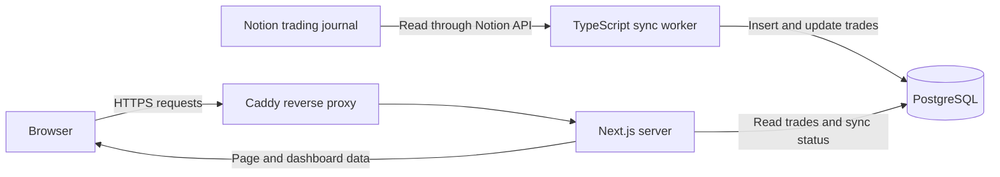
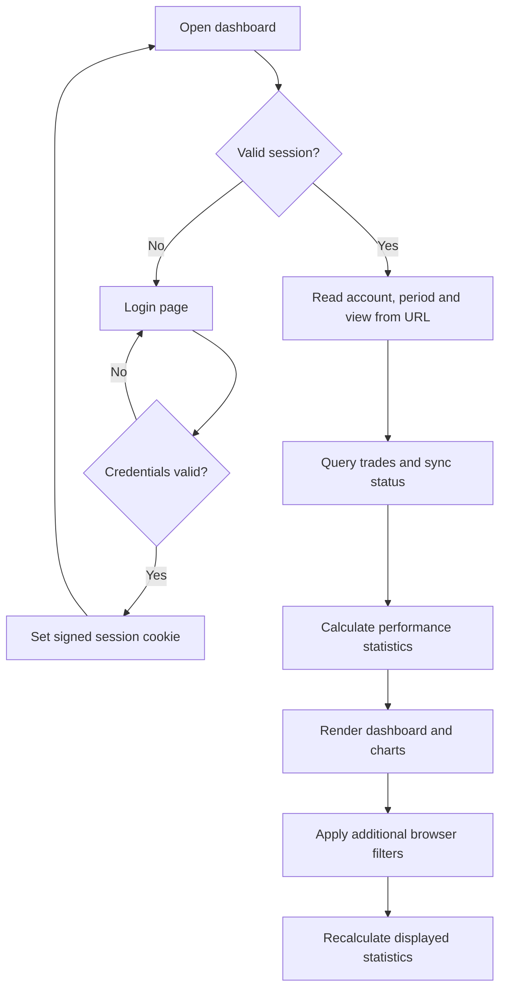

# GIMM Trading Dashboard

A personal trading dashboard built with Next.js, TypeScript and PostgreSQL. It turns the trades from my Notion journal into performance statistics, interactive charts and a searchable trade history.

## Why I built this

Notion worked well while my trading journal was small. As the database grew, it became slow, and updating performance charts from snapshots was tedious. I built this dashboard to automate that workflow.

Notion remains the single source of truth for my trades. A sync worker imports journal entries into PostgreSQL, and the dashboard turns them into current performance metrics, interactive charts and searchable history—without manually exporting snapshots.

## Architecture

The application has three services: a Next.js web application, a TypeScript synchronization worker and a PostgreSQL database. Docker Compose runs them together. The deployment configuration connects the web service to an existing Caddy HTTPS reverse proxy.



### 1. Notion: the original journal

Notion is the source of truth. Trades are created and edited there; the dashboard does not write changes back to Notion.

The adapter reads trade ID, account, entry time, instrument, position, net result in euros, account balance, R-multiple, setups and confirmations. It validates API responses with Zod and maps the properties into the application's `Trade` type. This mapping is specific to my journal: another Notion template may require changes in [lib/notion.ts](gimm-trading-dashboard/lib/notion.ts).

### 2. Worker: synchronization

The worker runs independently of the website. By default, it waits 180 seconds between completed synchronization attempts. Each run retrieves all available journal pages, following API pagination, then inserts new trades and updates existing ones using the Notion page ID as the key. This is a periodic full fetch, rather than an incremental feed or webhook integration.

Writes happen inside a database transaction. An advisory lock prevents overlapping runs from writing at the same time. Missing trades are removed only when the fetched dataset is nonempty and contains at least 60% of the previous row count, or when the database was empty. Otherwise, existing rows are retained and a warning is recorded. This helps avoid losing the stored history after an unexpectedly small API response.

Failed runs record an error when the database is reachable. The dashboard can still display the previously stored data together with its synchronization status.

### 3. PostgreSQL: the stored copy

| Table | Purpose |
| --- | --- |
| `trades` | Trade records, Notion identifiers and synchronization metadata. |
| `sync_status` | Last successful sync time, received trade count, state and error information. |

The website reads this copy instead of requesting Notion whenever someone opens a page. Page loading is therefore separate from Notion API availability. A Docker volume preserves the database across container restarts.

### 4. Next.js: backend and frontend

The backend and frontend belong to the same Next.js App Router project. There is no separate REST backend for trading data.

The server checks the session, reads the account and period from the URL, queries PostgreSQL and calculates the initial performance statistics. It passes the resulting payload to the React dashboard. Apache ECharts and TradingView Lightweight Charts render the visualizations in the browser.

Account and period changes trigger a server request. Additional filters run in the browser against the loaded trades and recalculate the displayed statistics. The four main views use the same route with different query parameters:

```text
/dashboard?view=analytics&account=Forwardtesting&period=90d
```

The browser refreshes server data every 90 seconds while the page is visible. A manual refresh button is also available. Refreshing reads PostgreSQL; it does not trigger a Notion sync. New trades appear after a successful worker run and a subsequent page refresh.



## How the statistics work

The main calculations live in [lib/analytics.ts](gimm-trading-dashboard/lib/analytics.ts), shared by the server and browser. A trade counts as closed for these calculations when it has a finite `Net €` value. Missing results are excluded from closed-trade statistics; zero counts as breakeven.

| Metric | Calculation |
| --- | --- |
| Net P&L | Sum of recorded net trade results. |
| Win rate | Winning trades divided by all closed trades, including breakeven trades. |
| Profit factor | Gross profit divided by absolute gross loss; unavailable when there is no gross loss. |
| Equity curve | Cumulative realized P&L, starting at zero. |
| Drawdown | Drop from the preceding peak of cumulative P&L, rather than an intratrade measurement. |
| Account balance | Values recorded in Notion, separately from cumulative P&L because they may include transfers. |

Notion Win/Loss tags are stored separately from Net €. Recorded confluence outcomes can include tagged trades without amounts; these trades remain excluded from financial statistics and display a missing-amount notice. Net € takes precedence over tags. TF Type comparisons include new tags automatically, including 5s Type 3. MFE/MAE read the exact journal fields `MFE(30 min)` and `MAE (30min)` without converting units; each average excludes only its missing measurements.

Calendar and timing groups use the configured timezone, defaulting to `Europe/Berlin`. Timing analysis uses entry times. Setup and session highlights require at least five closed trades per group. These comparisons describe the journal history; they are not predictions.

## Tech stack and design choices

| Technology | Role |
| --- | --- |
| Next.js 16, React 19, TypeScript | Server rendering, application routes and interactive UI. |
| Tailwind CSS, Radix UI, shadcn/ui-style components | Styling and reusable interface elements. |
| Apache ECharts, TradingView Lightweight Charts | Statistical charts and financial time series. |
| PostgreSQL 17, `pg` | Persistent storage and parameterized SQL queries. |
| Zod | Validation of Notion API responses. |
| TypeScript worker, Notion API | Periodic journal synchronization. |
| Docker Compose, Caddy | Service deployment and HTTPS routing. |

I kept the architecture small: one web application and one worker sharing a relational database. It fits a private dashboard without adding a separate API service, message queue or distributed job system.
