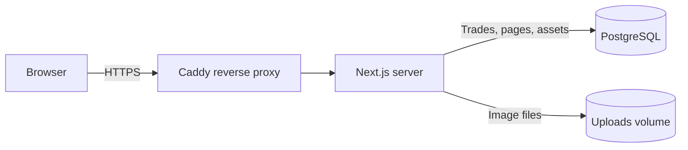

# Trading Dashboard

A private trading journal and analytics workspace built with Next.js, TypeScript and PostgreSQL. It replaces the previous Notion-based workflow: trades, reviews, playbooks and screenshots now live in this application and its own database.

## What it does

- **Trading dashboard** — performance metrics, equity curve, drawdown, calendar, setup/session comparisons, MFE/MAE excursion analysis and trader-skill scoring.
- **Trade journal** — every trade with search, outcome, instrument, setup, session, timeframe and direction filters, sorting, pagination and CSV export.
- **Journaling in the app** — create and edit trades through a form; the new-trade form accepts pasted or dropped chart screenshots and attaches them to the trade notes.
- **Trade review pages** — each trade has a page for notes and chart screenshots. Paste screenshots with `⌘V`/`Ctrl+V` or drag and drop them.
- **Trading Strategy** — the written playbook: process, timing, entry models, stop/target rules and the CBR/CBC algorithms. Every card, line and checkbox is editable in place and stored in `strategy_board`, so the page is a document rather than a hard-coded screen.
- **Full Notion field set** — setup quality, market condition, entry timeframe, TF alignment, order type, lot size, PnL %, learning notes and the granular outcome tag (Win / Small win / Loss / Small loss / B/E).
- **Column picker** — the journal has 27 columns; choose which ones you see, and the choice is remembered per browser. The default order reads like a trade review: trade → date → entry → exit → instrument → direction → screenshot → algorithm → quality → setup → market condition → confluences → entry TF → TF type → TF align → session → outcome → net P&L → PnL % → R → lots → order → MFE → MAE.
- **Two journal view modes** — every matching trade on one scrolling page, or 25 per page. Multi-value fields show every value; nothing is truncated behind a `+N`.
- **Readable at a glance** — every tag is a coloured box with one vocabulary: CBR blue / CBC green; setups `Continuation Block` and bare `Reversal` blue, `HTF`/`LTF Continuation` green, `HTF`/`LTF Reversal` red, `Prev Structure` and `Range Rejection` grey; market condition bearish red, bullish green, ranging grey; sessions London green, New York red, Sydney purple, Asia/Tokyo yellow. Timeframes climb the same ladder as setup quality: seconds grey, 1m yellow, 5m green, 15m blue, 1h purple, 4h+ prismatic. The realised PnL % is a ring that fills at 100 % and starts a second ring beyond it (a loss is always red).
- **Screenshots in the journal** — a chart thumbnail sits right of Direction. Click it to open the trade; press `⌘V` anywhere outside a text field to attach a copied chart, or drop a file. Existing screenshots can be viewed full size or removed from the same panel.
- **Inline editing** — open any trade from the journal, or open its trade page, and click a property to edit it: instrument, direction, setup, quality, session, timeframes, order type, lot size, R, PnL %, account balance, outcome and learning. The review dialog also keeps the Win / Loss / B/E switch and the confluence toggles.
- **Titan Quest style setup quality** — Common (grey), Magic (yellow), Rare (green), Epic (blue), Legendary (purple) and Ascension (prismatic), each with its own icon.
- **Public landing page** — the planet, the headline and two buttons. No form; Sign in and Sign up lead to their own pages.
- **Workspace** — a document-style workspace with nested pages, headings, lists, to-dos, quotes, callouts, code blocks, dividers and images. Useful for playbooks, rules and trade reviews.
- **Local images** — uploads are stored on a Docker volume and served only to authenticated sessions.

## Architecture



There is no synchronization worker and no Notion API call. Next.js is the only application process; the first request after a deployment creates or updates the database schema idempotently. The web process therefore needs write access to PostgreSQL and to the uploads volume.

The sidebar, top bar and mobile navigation live in `app/(app)/layout.tsx`. Keeping the shell in a layout is what stops the whole navigation from being rebuilt whenever a route changes.

The product is called **Master Trading Dashboard** on the sign-in screen and in the sidebar; the pages inside use their own names. The public landing page and the sign-in, register and reset screens share one backdrop (`components/video-backdrop.tsx`): two rendered clips of Earth from orbit, crossfading every two minutes. Portrait screens get 1080x1920 cuts and landscape screens 1920x1080 cuts, so a phone shows a properly framed scene rather than a letterboxed sliver. Both clips are preloaded and only their opacity is swapped, because changing `src` on a single element restarts decoding and flashes black. Playback pauses while the tab is hidden, and `prefers-reduced-motion` keeps a single still frame. Each auth screen adds its own scrim so the card and headline stay readable over whatever frame is on screen. The dashboard reuses the same backdrop in `ambient` mode: dimmed, fixed behind the panels, so the motion shows through the gaps while the tables stay opaque.

In light mode the backdrop is switched off entirely. A dark space video behind a white interface reads as grime — the panels go milky and every grey turns muddy — so light mode keeps its own clean surface instead.

```text
/                          public landing page (no form)
/login                     sign in
/register                  create an account
/login/reset               request a password reset
/dashboard                 overview
/calendar                  trading calendar
/journal                   master trading journal (the table)
/analytics                 analytics
/workspace                 document workspace
/workspace/[pageId]        notes page with block editor
/journal/new               create a trade
/journal/[tradeId]         trade review, notes and screenshots
/journal/[tradeId]/edit    edit recorded trade properties
/strategy                  the written trading playbook
```

## Data model

| Table | Purpose |
| --- | --- |
| `trades` | Recorded trade properties and realized results. Primary source of truth. |
| `pages` | Workspace pages. Trade pages are linked through `trade_id` and are created on demand. |
| `strategy_board` | Singleton row holding the editable strategy playbook as JSONB. |
| `assets` | Uploaded screenshots and their metadata; files live in `UPLOAD_DIR`. |

Trade columns carry the full journal schema. A few have deliberate semantics:

- `time_recorded` is false for rows that came from a date-only entry. Those trades still appear in the calendar and weekday statistics, but not in the entry-hour histogram, because inventing a clock time would distort it.
- `exit_time` comes from Notion date ranges (`start → end`).
- `recorded_outcome` is the normalised `win` / `loss` / `breakeven` used by the statistics. `outcome_tag` keeps the original granular label (`Small win`, `Small loss`, `B/E`).

Page content is stored as JSONB blocks. A block contains only plain text and an optional asset reference; it never contains raw HTML, so React escapes all journal text.

## Upgrading from the Notion version

The existing PostgreSQL data is kept; the new tables are created on the first request. Stop the old synchronization worker before starting the new stack, otherwise it could keep writing Notion data into the database:

```sh
docker compose down --remove-orphans
docker compose up -d --build
```

`NOTION_TOKEN`, `NOTION_DATA_SOURCE_ID` and `SYNC_INTERVAL_SECONDS` are no longer read and can be removed from `.env`. The legacy `sync_status` table and the `last_seen_run`/`synced_at` columns may remain; the application no longer uses them.

## Local setup

Requirements: Node.js 22.18+ and PostgreSQL 17 (or Docker). The application lives in `master-trading-dashboard/`.

```sh
cd gimm-trading-dashboard
cp .env.example .env
# Set DB_PASSWORD and the authentication values described below.
# For local PostgreSQL, also uncomment PGHOST=127.0.0.1 and PGPORT=5432.
npm ci
npm run dev
```

For a self-contained local test stack (its own PostgreSQL and uploads volume, nothing production):

```sh
./scripts/dev-stack.sh          # builds, starts and prints the login
./scripts/dev-stack.sh logs     # follow the web logs
./scripts/dev-stack.sh status   # container state
./scripts/dev-stack.sh down     # stop, keep data
./scripts/dev-stack.sh reset    # delete the local test data
```

The first run writes `.env.dev` and `.dev-credentials.txt` with generated credentials; both are git-ignored.

For the production-style stack:

```sh
docker compose up --build -d
```

The compose file uses an external Caddy network named `gimmholding-credentials_default`. Adjust it if your reverse proxy uses another network.

### Accounts and authentication

Sign-in is backed by the `users` table. Accounts are created either from the sign-in page (**Create account**) or from the command line:

```sh
npm run user:create -- --username "Tristan Gimm" --email you@example.com
npm run user:password -- --username "Tristan Gimm"   # rotate, signs out every session
```

Without `--password` a 24-character password is generated and written once to `.account-credentials.txt` (mode 600, git-ignored).

What is enforced:

- **scrypt** password hashes (N=32768, r=8, p=1) with a per-user salt.
- Minimum 12 characters; the password may not contain the username or the local part of the email.
- **Session cookies** are HMAC-signed, `HttpOnly`, `Secure` in production, `SameSite=Lax`, and carry a password version. Changing the password bumps that version, which invalidates every existing session.
- **Rate limits** on sign-in, registration, and both reset steps. These are per process; a multi-replica deployment needs a shared store.
- **No account enumeration**: a failed sign-in always says the same thing, and a reset request answers identically whether or not the address exists.
- **Reset tokens** are 32 random bytes, stored only as a SHA-256 digest, single use, valid for one hour. Requesting a new link invalidates the previous one.
- Login and reset forms are Server Actions, so they carry Next.js' built-in origin check; the smoke test asserts a cross-origin POST is rejected.

`AUTH_SECRET` (32+ characters) is required. `AUTH_USERNAME` and `AUTH_PASSWORD_HASH` remain supported as a **break-glass** login that works even when the database is unreachable; remove them once the database account is confirmed working.

### Email

Password reset needs an SMTP server. Set `SMTP_URL` (or `SMTP_HOST`, `SMTP_PORT`, `SMTP_SECURE`, `SMTP_USER`, `SMTP_PASS`) plus `MAIL_FROM`, and `APP_URL` so reset links point at the right host.

Without SMTP the message is appended to `MAIL_DIR/outbox.log` and the API reports it as *not delivered* — the UI never claims an email was sent when it was not. Read the outbox with:

```sh
docker compose exec web tail -20 /app/mail/outbox.log
```

### Uploads

`UPLOAD_DIR` defaults to `./uploads` in development and is `/app/uploads` in Docker. `MAX_UPLOAD_MB` defaults to 12. Only PNG, JPEG, GIF and WebP are accepted, validated by magic bytes rather than the client-provided MIME type.

## Checks

```sh
npm run typecheck
npm test
npm run build
npm run test:smoke
npm run test:browser -- --built
```

The browser check runs the local demo server with synthetic trades and exercises login, charts, filters, journal, calendar, analytics, mobile layouts and keyboard accessibility.

## The three products

The landing page is shared with two sibling applications:

- **Master Trading Dashboard** — this repository, `dashboard.gimmholding.com`
- **Quant Engine** — `../Quant Engine` (Twisted + Python), `quant-engine.gimmholding.com`
- **Copier Engine** — `../Trade-Copier` (Python), `copier-engine.gimmholding.com`

They run on different stacks, so the page is generated from one template and written into each app's static directory:

```sh
node scripts/build-landing.mjs
```

The header of every screen carries one **Navigation** bar listing all three products inline. It is not a dropdown: with three items a
menu only hides the thing it exists to show.

That writes `landing.html`, `landing.js` and the video files into `../Quant Engine/web/` and `../Trade-Copier/public/`. Edit
`scripts/build-landing.mjs`, never the copies. The generated page carries the product's own name and a switcher listing all three.

Each app serves it at `/` for anonymous visitors and keeps its own sign-in. Quant Engine (`dashboard_auth.py`) returns the landing
instead of redirecting, and serves `/videos/*` and `/landing.js` publicly. Copier Engine (`server.py`) serves the landing at `/` and
moves the application itself to `/app`. The script is an external file, not an inline block, because the copier sends `script-src 'self'`.

**One credential across all three.** All three sign in with a username and a password — `Tristan Gimm` plus the same secret — and all
three offer Sign in, Sign up, Create account and Forgot password on the same shaped page with the same video behind it.

Registration and password reset are gated by a server-side setup token in the Quant and Copier engines (`DASHBOARD_SETUP_TOKEN` and
`SETUP_TOKEN`). They are private workspaces, so an open sign-up form would be a hole rather than a feature. The dashboard still has real
self-service registration and email reset.

## Importing a Notion export

Notion exports a CSV plus one Markdown file per row. Import the CSV:

```sh
npm run import:notion -- "/path/to/Master Trading Journal ... .csv" --dry-run
npm run import:notion -- "/path/to/Master Trading Journal ... .csv" --replace
```

`--dry-run` prints the parsed counts without writing. `--replace` deletes existing trades first; without it, rows are appended.

### Importing the chart screenshots

In Notion, open the journal database → **⋯ → Export** → **Markdown & CSV**, switch on **Include content**, then download the **ZIP**. The ZIP is the only format that contains the image files; a CSV or Markdown file on its own carries just the path.

For the local Docker stack there is one command that does the whole job — trades, screenshots, database rows and the uploads volume:

```sh
cd master-trading-dashboard
./scripts/import-notion-into-dev.sh "/path/to/Export.zip" --images-only   # screenshots onto the trades you already have
./scripts/import-notion-into-dev.sh "/path/to/Export.zip" --dry-run       # parse only, write nothing
./scripts/import-notion-into-dev.sh "/path/to/Export.zip"                 # trades + screenshots
```

The script imports on the host (only there is the ZIP reachable), writes the images to a staging folder, and copies them into the running `web` container, because a Docker Desktop volume is not a host directory. Re-running is idempotent: an image already attached is skipped by filename.

Without Docker, the importer is the same script:

```sh
npm run import:notion:export -- "/path/to/Export.zip" --dry-run
npm run import:notion:export -- "/path/to/Export.zip" --images-only
```

How images are matched: the CSV's `Analysis` path first (so the property screenshot lands on the right trade), then every other image in that row's own numeric folder — Notion stores inline page images as `image.png`, `image 1.png`. Trades whose row has no image are listed at the end, as are files that could not be matched. Nothing is dropped silently.

Two caveats:

- **`--replace` deletes every trade first**, including trades created in the app that are not in the CSV, together with their notes and screenshots. Use `--images-only` when the trades are already imported.
- A CSV exported without **Include content** has no image files at all. Export again and pass the new ZIP.

The CSV import also reads `Time` values with or without a clock time, including ranges with `(GMT±n)` offsets. Impossible dates are rejected rather than shifted.

## Backups

`scripts/backup.sh` writes a compressed PostgreSQL dump and a separate archive of the uploads volume to `/root/trading-backups` by default:

```sh
cd gimm-trading-dashboard
./scripts/backup.sh /path/to/backups
```

Restore the database with `gunzip -c trading-<timestamp>.sql.gz | docker compose exec -T db sh -c 'exec psql -U "$POSTGRES_USER" "$POSTGRES_DB"'` and extract the uploads archive over the `trading_uploads` volume.
